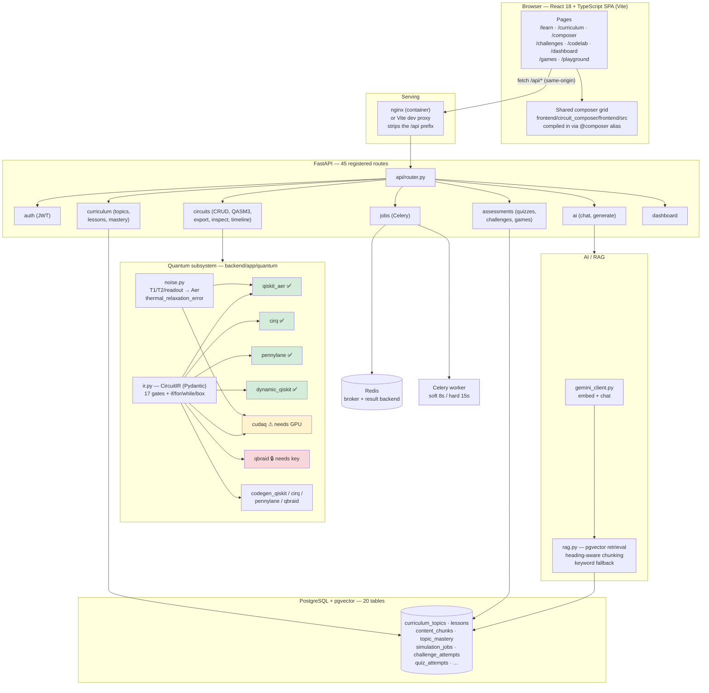
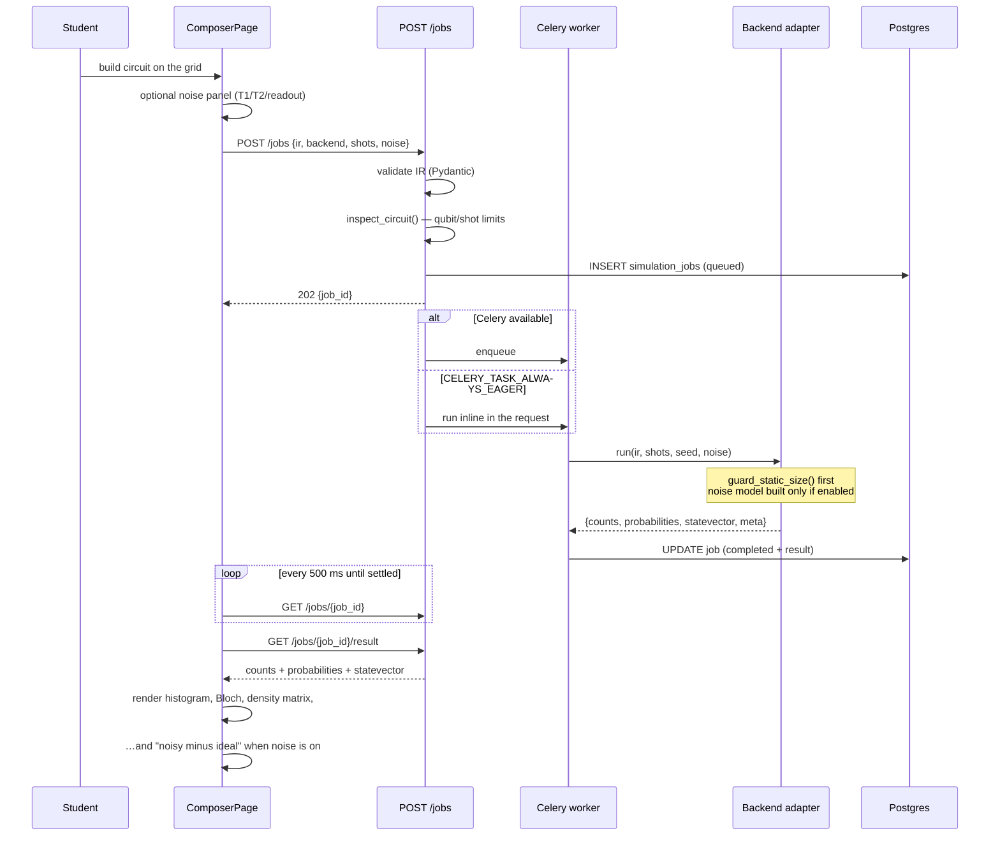
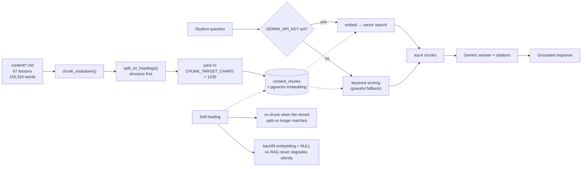
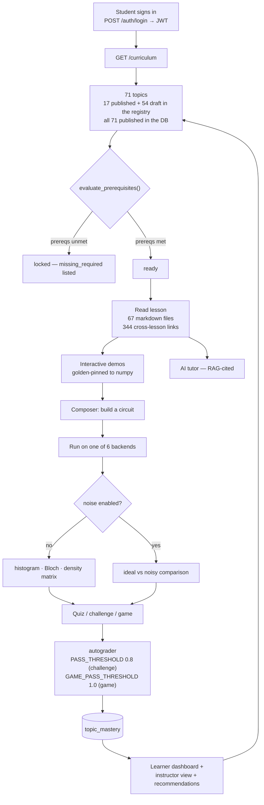
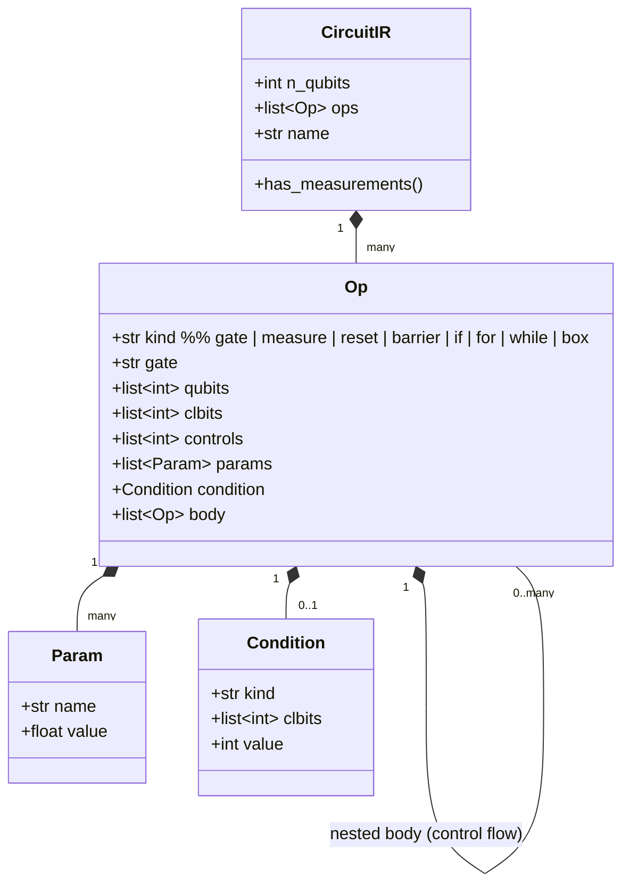
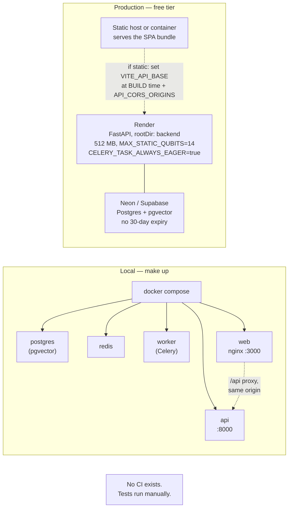

# Architecture Diagrams

All diagrams are derived from the code as it stands, not from intent. Route and
table counts were measured by importing the app and walking its routes/models.

---

## 1. System architecture

✅ runs with no credentials · ⚠ needs a GPU · 🔒 needs a paid key

---

## 2. Simulation request flow

**Where the run hash matters:** `test_noise_model.py::test_run_hash_separates_noisy_from_ideal_runs`
ensures a noisy run never shares a cache entry with an ideal one.

---

## 3. RAG pipeline

Measured: `content/01_qubits.md` (13,497 chars) → **14 chunks**.

---

## 4. Learning workflow

---

## 5. Circuit IR object model

Gate set (17): `h x y z id swap s sdg t tdg sx p rx ry rz`
Controlled aliases: `cx/cnot`, `ccx/toffoli`, `mcx` (arbitrary controls), `cz`,
`cy`, `cp`, `crz`, `cswap/fredkin`.
Control flow: `if`, `for`, `while`, `box` — with `WHILE_CAP = 32`,
`FOR_LOOP_CAP = 1024`.

---

## 6. Deployment topology

**Note:** `VITE_API_BASE` is compiled in at build time — changing the API URL
requires a rebuild, not a config edit. If you serve the bundle behind an nginx
that proxies `/api`, leave it unset and CORS never enters the picture.
